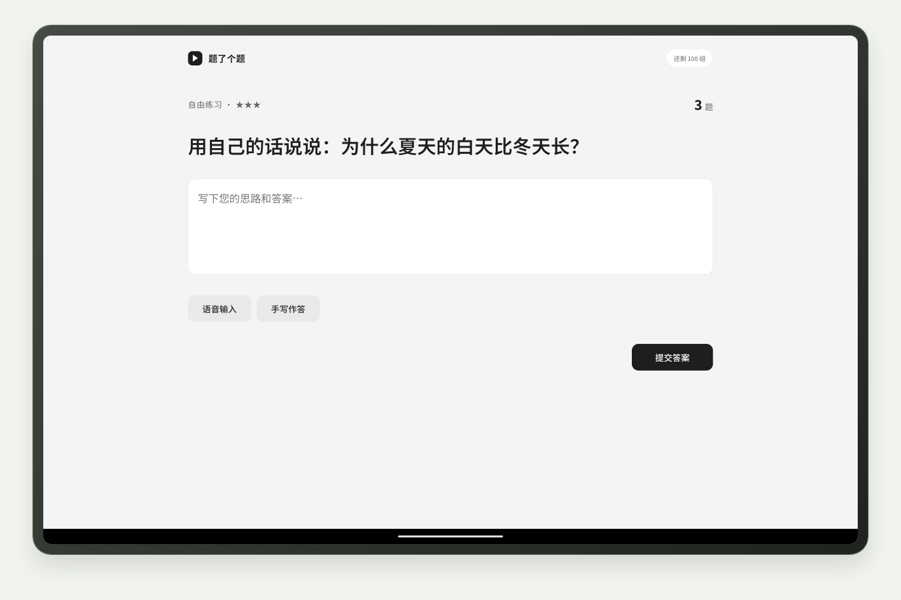
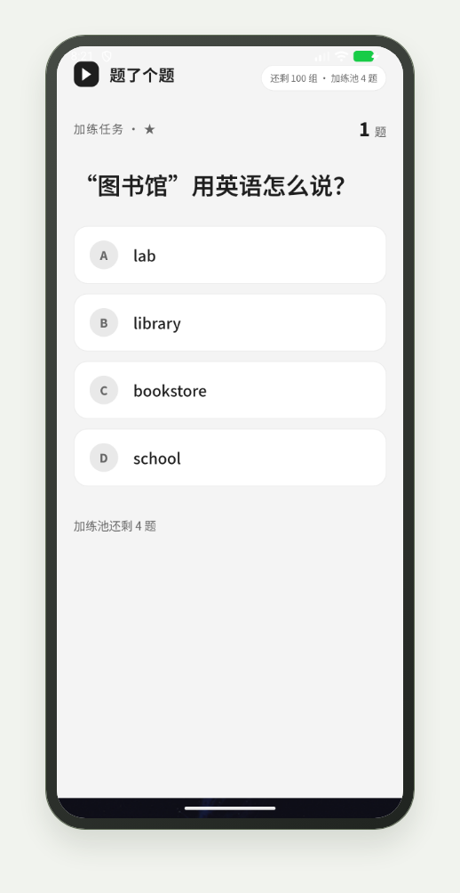
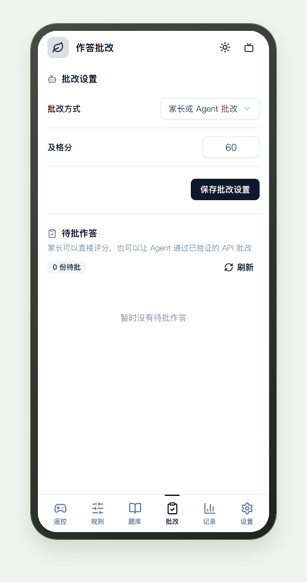
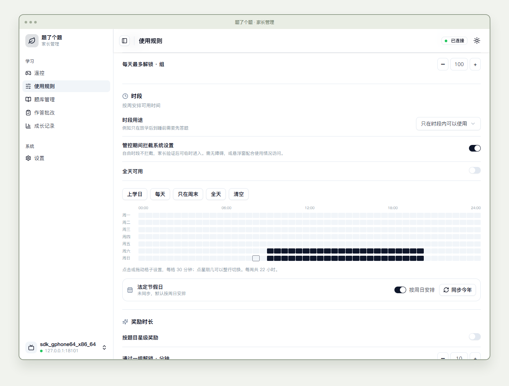
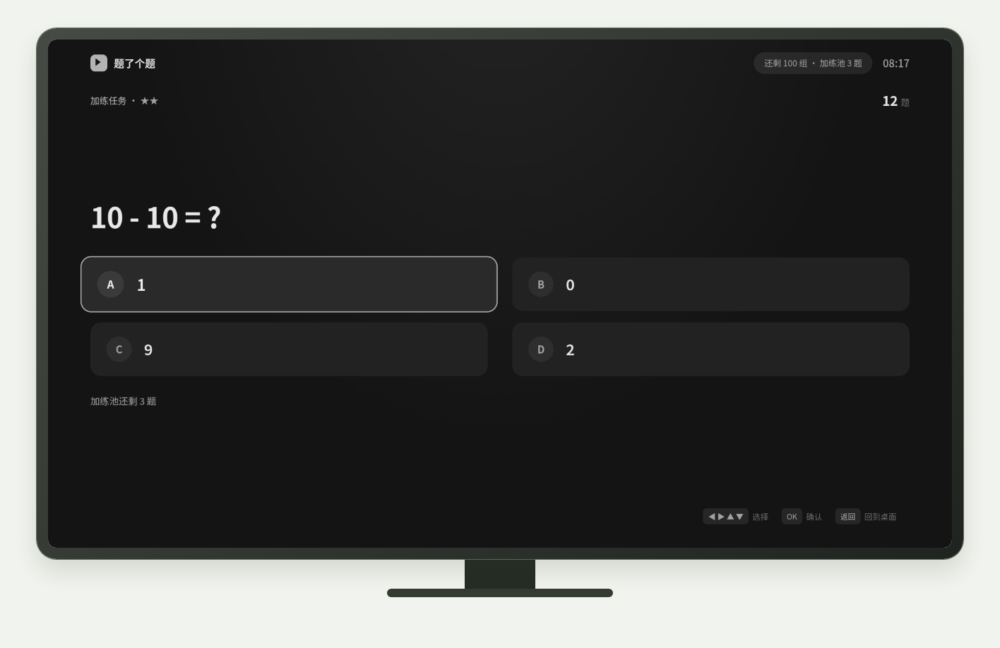

# StudyOnTV

An Android learning and screen-time app for tablets, phones and TVs. Tablets and phones use the Mobile APK; TVs use a separate lightweight TV APK. Both keep question banks, progress and usage records locally.

This project is linked with and endorses the [LINUX DO](https://linux.do) community.

[Download from GitHub Release](https://github.com/chadyi/StudyOnTV/releases/latest) · [中文说明](./README.md) · [Installation](./docs/install.md)

If GitHub is unavailable, use the Pgyer backup: [Mobile / tablet](https://www.pgyer.com/StudyOnTVMobile) · [TV](https://www.pgyer.com/StudyOnTVTV).

## Learning

- Single choice, multiple choice, true/false, short answers and subjective questions.
- Offline LaTeX formulas through bundled KaTeX and fonts.
- Keyboard input, system speech-to-text and handwriting images.
- Round-based tasks, correct-answer streaks and unrestricted practice.
- Configurable rewards for questions rated 1–5 stars.
- Answer feedback below each question: right or wrong, the correct answer and the explanation; the child continues when ready. Parents can edit the encouragement phrases.
- Remote-friendly TV interface with Netflix-style focus, dark and light modes, and system keyboard or voice input for typed answers. Videos behind the learning overlay are paused.
- Optional spaced repetition prioritizes due questions and keeps learning progress across restarts.
- Persistent extra-practice pool: mistakes add questions at a configurable threshold; correct extra-practice answers repay the pool. Restarting or changing the date does not erase the pool.

## Parent management

The controlled device hosts its own local HTTP panel. Parents connect over the same network and enter the management password set during initial setup. Tap the application title five times, or press D-pad Up five times while focus is at the top, to reopen the password-protected connection screen.

The panel separates rules, question banks, grading and usage records. APIs require authentication as well; the former six-digit access code and unauthenticated question-bank access have been removed.

Subjective submissions can be graded by a parent, an authenticated Agent, or an optional OpenAI-compatible AI endpoint such as DeepSeek, Qwen, Zhipu, Kimi, SiliconFlow or a local Ollama server, with built-in presets, a connection test and model list fetching. Handwriting requires a vision-capable model or human review. Failed AI calls preserve the submission for later review. Enabling AI sends question and answer content to the configured provider.

[Question-bank and grading API](./docs/ai-api.md) · [Gameplay rules](./docs/gameplay.md) · [Example question bank](./data/banks/open-play.json)

## Screenshots

<table><tr>
<td align="center"> Phone learning</td>
<td align="center"> Parent review and AI settings</td>
</tr></table>

## Screen-time limits

Native Android code validates answers and awards time. Actual foreground app use consumes the persisted balance; study, launcher, locked-screen and screen-off time do not. Limits include daily usage, daily rewarded rounds and allowed hours, including overnight windows.

Schedules can either allow device use only within the selected hours, or require learning only within those hours. The latter leaves the rest of the day free, without consuming the earned balance. Both support overnight windows and an explicit all-day option.

All permissions are optional. Accessibility, or overlay permission combined with usage access, can identify apps and enforce limits. Overlay-only mode approximates awake time away from the learning screen. During controlled periods, parents can enable Settings interception; local parent verification temporarily permits access, and free periods remain unrestricted. Optional device-admin activation discourages normal uninstallation on supported devices. Force-stop, revoked permissions and manufacturer background policies can interrupt enforcement.

Android boot, supported quick-boot broadcasts and package replacement can restart the management service after initial setup. A TV remote's standby action or manufacturer task cleanup may not send a boot broadcast; allow autostart/background running and verify the behavior on the actual device.

## Community suggestions

Thanks to **xiuweng** on LINUX DO for mobile control, the hidden management entry and persistent extra practice; and to **free-swimming** for star difficulty and different time rewards.

Suggestions from [#2](https://github.com/chadyi/StudyOnTV/issues/2) improved password changes, AI presets, question-bank management and lazy loading. [#3](https://github.com/chadyi/StudyOnTV/issues/3) led to inline answer feedback and manual continuation; [#4](https://github.com/chadyi/StudyOnTV/issues/4) informed control-hour schedules, optional uninstall protection and stronger background-audio handling. [#5](https://github.com/chadyi/StudyOnTV/issues/5) prompted clearer boot-startup guidance.

## License

Source available for personal, non-commercial household use under [LICENSE](./LICENSE). The project is not MIT-licensed. Third-party components retain their own licenses; see [third-party notices](./THIRD_PARTY_NOTICES.md).
